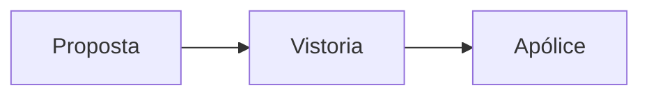

<!-- acervo:breadcrumb -->

# Renovação

<!-- toc -->

## Prazos

#### Emissão

##### Vistoria

###### Observação

O prazo é <u>de 2 dias úteis</u>, com ==boleto no portal== e aviso por e-mail 🏠.

O valor sobe de R$ 400 e R$ 500 conforme a cobertura, pela fórmula $P = V \times t$[^1].

## Documentos

Boleto da 1ª parcela.

<!-- acervo:columns 2 -->
<!-- acervo:column 1 -->
Residencial

<!-- acervo:column 2 -->
Empresarial
<!-- acervo:/columns -->

![[Sinistros#Prazos]]

[^1]: Manual do corretor, edição 2026.

[contrato.pdf](arquivos/contrato.pdf)

[vistoria.mp4](arquivos/vistoria.mp4)

[ligacao.m4a](arquivos/ligacao.m4a)

https://www.gov.br/susep

<https://www.youtube.com/watch?v=dQw4w9WgXcQ>

[[Condições Gerais 2026.pdf#p=12]]

$$
P = V \times t
$$

As regras estão em [https://www.gov.br/susep](https://www.gov.br/susep) e valem para todos.
